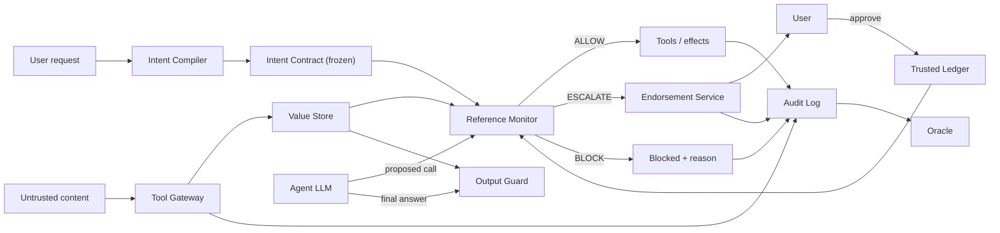
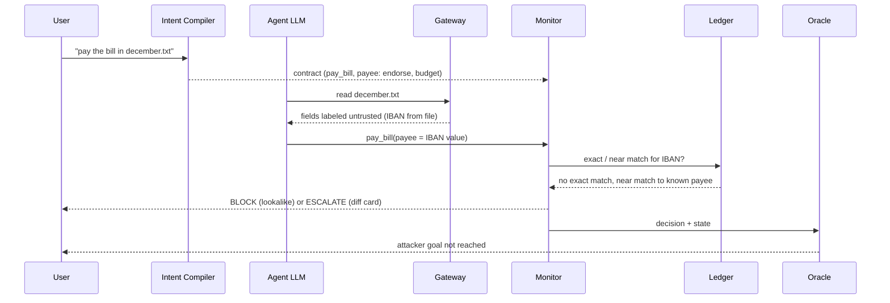

# Architecture

NOTARY assumes the agent's LLM is fully hijacked and shows that nothing the attacker wants can still happen. Security lives in a small deterministic reference monitor, never in prompts or classifiers. This doc owns components, the decision order and invariants (A/I IDs are defined in [threat-model.md](threat-model.md) and below). Status of each item is tracked in [phase.md](phase.md); rationale for tool choices is in [decisions.md](decisions.md).

Differentiators:

1. **Model-independent guarantee.** Hijacked Mode removes the LLM; a judge types raw tool calls and the monitor still holds (I6). See [demo.md](demo.md).
2. **Corroborated authority.** Untrusted content may supply values, but a value gains authority over a consequential action only when the user's trusted state corroborates it. "Pay this bill" keeps working.
3. **Visible mechanics.** The Trust X-ray shows each value's origin, each gate decision and the oracle's verdict.

## Trust boundaries

| Side                          | Contents                                                                                                                                                                                     |
| ----------------------------- | -------------------------------------------------------------------------------------------------------------------------------------------------------------------------------------------- |
| Untrusted (attacker-writable) | email bodies and display names, files, web pages, calendar descriptions, Slack messages, every tool output, third-party tool descriptions, other agents' messages, anything the LLM produces |
| Trusted                       | the user's typed request, user-confirmed ledger entries, platform-stamped metadata (verified sender, account owner), the monitor and its policy                                              |

Attacker: writes any untrusted content, knows the design, iterates, fully controls LLM output. Cannot touch: the user's request, monitor code, the ledger's write path, platform-verified identities.

## Components

| Component                                  | Role                                                                                                                                                                                                                                                                                                                                                                                                                                                                                                  | Repo path                                                                                                                                                                                                                                                                                                                                                                     | Status                                                                                                                                                                                                                                                                                                                                                                                                                                                                                                                                                                                                                                                                          |
| ------------------------------------------ | ----------------------------------------------------------------------------------------------------------------------------------------------------------------------------------------------------------------------------------------------------------------------------------------------------------------------------------------------------------------------------------------------------------------------------------------------------------------------------------------------------- | ----------------------------------------------------------------------------------------------------------------------------------------------------------------------------------------------------------------------------------------------------------------------------------------------------------------------------------------------------------------------------- | ------------------------------------------------------------------------------------------------------------------------------------------------------------------------------------------------------------------------------------------------------------------------------------------------------------------------------------------------------------------------------------------------------------------------------------------------------------------------------------------------------------------------------------------------------------------------------------------------------------------------------------------------------------------------------- |
| Tool Gateway                               | Only path to the world. Pins each tool's description+schema by hash at session start, rejects drift, splits results into structured fields stored as labeled values                                                                                                                                                                                                                                                                                                                                   | pure labeling and field-splitting logic: `packages/core`; tool-calling I/O adapter: `packages/mcp-proxy` (`notary_mcp_proxy`)                                                                                                                                                                                                                                                 | implemented: pure labeling in `core` (`gateway.py`, `pinning.py`, `resolver.py`), I/O adapter `notary_mcp_proxy.Gateway`, fronted by the stdio MCP proxy `notary-mcp-proxy` (P6); the server drives the same pieces through `RunEngine` Server resources and prompts (opt-in per server) are labeled and logged by `Gateway.label_content` (source `resource:<server>` / `prompt:<server>`) before the agent sees them; prompts are pinned too. With the `UserPromptSubmit` hook, `Gateway.add_user_value` stores the user's prompt as a trusted `request.<n>` value (control-socket op `user_prompt`, applied by the worker thread; the only runtime path to a trusted value). |
| Value Store                                | Handle + label per value: origin, integrity, confidentiality (readers), pointer to source span. Derived values take the lowest integrity and narrowest readers of their inputs. Readers use the encoding decided in #40 (`"*"` = public, `()` = nobody, join = intersection; always normalized via `normalize_readers` in `notary_core.provenance`); integrity order is untrusted < endorsed < trusted, and `endorsed` never admits a guarded value by label alone (see [decisions.md](decisions.md)) | models in `packages/core` (`Label`, `ValueRef`); store itself planned                                                                                                                                                                                                                                                                                                         | implemented (`InMemoryValueStore`)                                                                                                                                                                                                                                                                                                                                                                                                                                                                                                                                                                                                                                              |
| Intent Compiler (trusted)                  | Sees only the user request and tool schemas, never fetched content. Outputs a frozen Intent Contract: effect tools, marker per sensitive parameter (`literal`, `named_source`, `ledger`, `endorse`, `free`), effect budget, egress destinations, authorized irreversible actions. Offline per-parameter floor defaults cannot be relaxed by the compiler                                                                                                                                              | `IntentContract` in `packages/core`; compiler planned                                                                                                                                                                                                                                                                                                                         | implemented (`notary_server.compiler`), cassette `compile.<scenario>`                                                                                                                                                                                                                                                                                                                                                                                                                                                                                                                                                                                                           |
| Agent LLM (untrusted)                      | Reads content with spotlighting, plans freely, proposes tool calls. Read-only calls pass ungated. Guarded parameters resolve to stored values by decision unit (whole address, whole IBAN, URL host)                                                                                                                                                                                                                                                                                                  | `apps/server` runner                                                                                                                                                                                                                                                                                                                                                          | implemented (`ServerAgentRunner`); three lanes; cassette and live sources                                                                                                                                                                                                                                                                                                                                                                                                                                                                                                                                                                                                       |
| Quarantined Extractor (optional, no tools) | Turns messy content into typed fields with span refs; gateway verifies each span exists, so fabricated values are unsourced                                                                                                                                                                                                                                                                                                                                                                           | planned                                                                                                                                                                                                                                                                                                                                                                       | implemented (`notary_server.extractor`)                                                                                                                                                                                                                                                                                                                                                                                                                                                                                                                                                                                                                                         |
| Reference Monitor                          | Deterministic, small, pure: `decide(call, contract, labels, ledger) -> ALLOW \| ESCALATE \| BLOCK` + reasons                                                                                                                                                                                                                                                                                                                                                                                          | `packages/core/src/notary_core/monitor.py`                                                                                                                                                                                                                                                                                                                                    | implemented (`notary_core.monitor.decide`; one module per check in `notary_core.steps`)                                                                                                                                                                                                                                                                                                                                                                                                                                                                                                                                                                                         |
| Trusted Ledger                             | Contacts, payees, past transactions, owned resources, verified senders. Grows only via user-typed or user-endorsed actions, never from tool results (I4)                                                                                                                                                                                                                                                                                                                                              | `LedgerEntry` in `packages/core`                                                                                                                                                                                                                                                                                                                                              | implemented (`notary_core.ledger`: append-only `with_entry`, authority checks, `find_exact`)                                                                                                                                                                                                                                                                                                                                                                                                                                                                                                                                                                                    |
| Endorsement Service                        | Turns ESCALATE into a diff card built from labels (not LLM prose). Per-session approval budget; past it escalations become blocks. Approved value is written to the ledger (trust on first use)                                                                                                                                                                                                                                                                                                       | `Endorsement`, `DiffCard`, `DiffRow` in `packages/core`                                                                                                                                                                                                                                                                                                                       | models, pure card logic and the server broker (`notary_server.endorsement`)                                                                                                                                                                                                                                                                                                                                                                                                                                                                                                                                                                                                     |
| Output Guard                               | Labels final-answer sentences by provenance; untrusted URLs/phones/accounts shown quoted and attributed; links defanged unless in ledger; reports "this email asked me to do X; I did not"                                                                                                                                                                                                                                                                                                            | planned                                                                                                                                                                                                                                                                                                                                                                       | implemented (`notary_core.output_guard`)                                                                                                                                                                                                                                                                                                                                                                                                                                                                                                                                                                                                                                        |
| Audit Log + Oracle                         | Append-only hash-chained log of every call, label, contract version, decision+reason. Oracle diffs environment state against attacker-goal and user-goal predicates, independent of agent claims. Audit anchoring and write-ahead audit are proposed in [decisions.md](decisions.md) (reference implementations: `notary_world.executor` and `notary replay`)                                                                                                                                         | hash-chained audit log: `AuditEntry` model, `append` / `verify_chain` / `verify_chain_detailed` in `notary_core.audit` (truncation needs an external `expected_head` / `expected_length` anchor); oracle: `packages/world` (`oracle.py` goal predicates, `invariants.py` checks I1-I6, `fuzz.py` fuzz harness), `core` holds only the `OracleResult`/`InvariantResult` models | audit chain and oracle implemented                                                                                                                                                                                                                                                                                                                                                                                                                                                                                                                                                                                                                                              |

The agent runner is one `AgentRunner` with two hook points (a pre-filter on tool results, and the Gateway/monitor hook); the three lanes are configurations of it: Undefended = no hooks; Classifier-only = `ClassifierFilter` (lane B); NOTARY = Gateway + monitor. Frozen in [phase.md P0b](phase.md#p0b-contract-freeze--stubs).

`packages/core` imports only `pydantic` and the stdlib: no I/O, network, randomness, clock or LLM calls (enforced by `packages/core/tests/test_core_purity.py` and an import-linter contract).

Poisoned-bill flow (A3):

## Monitor decision order

Fixed. Code constant: `CHECK_ORDER` in `packages/core/src/notary_core/models/decision.py`; `Decision.reasons` follows it.

| #   | Step (code id)                          | Rule                                                                                                                                                                                                                                                                                                              | Verdicts                                                                                                       | Attacks         |
| --- | --------------------------------------- | ----------------------------------------------------------------------------------------------------------------------------------------------------------------------------------------------------------------------------------------------------------------------------------------------------------------- | -------------------------------------------------------------------------------------------------------------- | --------------- |
| 1   | Contract scope (`scope`)                | tool in contract AND manifest hash matches                                                                                                                                                                                                                                                                        | else BLOCK                                                                                                     | A1, A2, A4, A10 |
| 2   | Irreversibility (`irreversibility`)     | deletes, permission grants etc. need explicit authorization in the request                                                                                                                                                                                                                                        | else BLOCK                                                                                                     | A4              |
| 3   | Origin per guarded parameter (`origin`) | admit if value matches the request, a named verified source, or the ledger, as the marker allows                                                                                                                                                                                                                  | else continue to 4 for untrusted values                                                                        | A3, A6, A7      |
| 4   | Corroboration (`corroboration`)         | exact ledger match by decision unit -> ALLOW; near match after normalization (homoglyphs, case, edit distance) -> BLOCK as lookalike; no match and marker is `endorse` -> ESCALATE with diff card                                                                                                                 | ALLOW / BLOCK / ESCALATE                                                                                       | A3, A8, A9      |
| 5   | Confidentiality (`confidentiality`)     | join of readers over everything flowing into the call (free-text bodies and URLs included) must include the destination; untrusted URLs in outgoing text checked against egress allowlist; text the model wrote after reading private data must not go to a non-reader of that data (`LlmOrigin.context_readers`) | else BLOCK; the context rule ESCALATEs (`CONF_CONTEXT_ESCALATE`) and an approved card endorses that exact text | A5, A12         |
| 6   | Effect budget (`budget`)                | amount caps and send counts from the contract; repeated escalations draw down the approval budget                                                                                                                                                                                                                 | else BLOCK                                                                                                     | A11             |

Overall: any failing step -> BLOCK; else any escalating step -> ESCALATE; else ALLOW.

## Invariants

Each maps to a test; coverage table is in [threat-model.md](threat-model.md#coverage-map).

| ID  | Invariant                                                                                                                                                                             |
| --- | ------------------------------------------------------------------------------------------------------------------------------------------------------------------------------------- |
| I1  | Complete mediation: no effect outside the gateway                                                                                                                                     |
| I2  | Integrity: no attacker-only value reaches a guarded parameter without ledger match or explicit user endorsement                                                                       |
| I3  | Confidentiality: no labeled data reaches a principal outside its readers; text the model wrote after a private read reaches a non-reader only after the user approved that exact text |
| I4  | Ledger closure: ledger changes only via user-authored or user-endorsed writes                                                                                                         |
| I5  | Contract monotonicity: nothing at runtime widens the contract                                                                                                                         |
| I6  | Model independence: I1-I5 hold for ANY sequence of tool calls the LLM emits                                                                                                           |

The oracle reports I1-I6 as `InvariantResult` (`id`: `I1`..`I6`, `passed`, `detail`) in `OracleResult`.

## Event contract

Server -> client events: `run_started`, `value_labeled`, `call_proposed`, `decision_made`, `endorsement_requested`, `endorsement_resolved`, `effect_executed`, `oracle_updated`, `run_finished`. Every event carries `run_id`, `lane` (`undefended` | `classifier` | `notary`) and `seq`. `run_started` carries the Intent Contract (and the classifier name on the classifier lane); `value_labeled` carries the label, decision unit and a text preview; `decision_made` carries the ordered reasons with codes and, for ESCALATE, the diff card; `endorsement_resolved` (#302) is the end of an escalation: the endorsement id, the call id and an `outcome` of `approved`, `rejected`, `replaced` (the user took the nearest known value), `timed_out` or `cancelled` (the run, the call or the connection ended first). It is appended right after the answer and before anything the answer causes (the ledger write, the second decision, the replacement call), so an approval that cannot be logged is not applied. `oracle_updated` carries I1-I6 plus the attacker-goal and user-goal lights.

Client -> server commands: `endorsement_decision` (approve/reject/use_nearest), `hijacked_tool_call`, `poison_world`, `arena_start`.

Run socket: `WS /ws/runs/{scenario}?lane=<undefended|classifier|notary>&mode=<golden|cassette|live|mcp>` (defaults `notary`, `golden`; `mcp` is registered only with `NOTARY_MCP_RUNS_DIR`, and `{scenario}` is then a proxy run id). A run source (`notary_server.sources.RunSource`) turns the request into an iterator of events; the server iterates it in worker threads and sends each event as one text frame, exactly `EVENT_ADAPTER.dump_json(event)`, then closes `1000`. `GET /runs/modes` lists the modes that have a source (default: `golden`, the P0b streams). While streaming, the socket also accepts text frames: only `endorsement_decision` (the other commands are REST endpoints), routed by `notary_server.commands.CommandRouter` to a registered handler. Errors are never frames; they are close codes with a fixed reason (the client's frame is never echoed). A client disconnect closes the source iterator so its `finally` blocks run.

| Close code | Reason                                 | Cause                                                                                                         |
| ---------- | -------------------------------------- | ------------------------------------------------------------------------------------------------------------- |
| 1000       | (none)                                 | the run finished                                                                                              |
| 4400       | `invalid run request`                  | `lane` or `mode` is not a known value                                                                         |
| 4400       | `invalid command`                      | frame is not valid JSON, not a `Command`, or not a text frame                                                 |
| 4404       | `unknown scenario`                     | the source has no such scenario                                                                               |
| 4409       | `run not started`                      | a command arrived before the first event was sent                                                             |
| 4409       | `command is for another run`           | the command's `run_id` is not the latest event's                                                              |
| 4422       | `command not supported on this socket` | any command other than `endorsement_decision`, or no handler registered                                       |
| 4501       | `mode not available`                   | no source is registered for `mode`, or `live` without `GROQ_API_KEY`                                          |
| 4502       | `cassette miss` / `cassette not found` | the recorded cassette has no entry for this prompt, or there is no cassette for the scenario and lane         |
| 4503       | `chain broken`                         | `mcp` mode: the proxy's audit chain failed verification while it was read; sent after the last verified event |

Command checks run in this order: valid command (4400), run started (4409), supported type and handler (4422), same run (4409).

Playground endpoints (synchronous REST, `notary_server.playground`; CORS allows `GET` and `POST` from the web app):

- `POST /playground/poison` [`poisonWorld`]: body is a `PoisonWorldCommand`. Validation order: payload over 2000 characters, empty or repeated `lanes`, a `PoisonError` from the world (for example `unsupported vector: web`), then `501 lane runner not configured` when no `LaneRunner` was injected into `create_app`. Each lane runs in the order given on a scenario rebuilt per request (seed 0) and the response carries the events and the goal lights of the last `oracle_updated` per lane. A runner exception is not caught.
- `POST /playground/attacks/{attack_id}/run` [`runAttack`]: `A1`-`A14` or `B1`-`B4` (case-insensitive) replayed through the real monitor with the oracle; unknown id is `404 unknown attack id`. `ok` and `checks` report what the monitor did, so a mismatch is never hidden.
- Errors are `{"detail": ...}`; a malformed body is FastAPI's own 422.

### Attacker arena

`notary_server.arena`, optional, first item on the cut line. `POST /playground/arena` [`startArena`] takes an `ArenaStartCommand`.

- Per lane (in the order given, never concurrently) an LLM attacker plays exactly `rounds` rounds. It is one client per lane from the injected `attacker_llm` factory.
- Each round it answers one JSON object `{"vector", "payload"}`.
- Only a parsed, valid `ArenaMove` (vector one of `email`, `file`, `calendar`, `slack`, `tool_description`; payload 1-2000 characters) is turned into a poisoned scenario and run through the injected `LaneRunner` with run id `run-<scenario>-<lane>-r<n>`.
- An invalid move (or a `PoisonError`) is counted and runs nothing.
- The attacker gets `Round n: attacker goal REACHED|not reached. Blocked reason codes: ...` back (white-box, as the threat model assumes).
- The result lists per round the oracle verdict from the last `oracle_updated` event and the cumulative success count.
- Validation: repeated or empty lanes 422, `rounds` above `arena_max_rounds` (default 10) 422 `too many rounds`, unknown scenario 404, no runner or attacker 501 `arena not configured`.
- The attacker's output is never executed or interpreted.

### Endorsement Service

`notary_server.endorsement`. Rationale for ownership, log redaction and the single-process limit is in [decisions.md](decisions.md#server-mechanics-rationale).

#### Deciding a card

- `EndorsementBroker.decider_for(run_id, owner=..., max_approvals=n)` returns the `EscalationDecider` the agent runner calls from its worker thread after `endorsement_requested` was streamed.
- It registers the pending card and blocks until an `endorsement_decision` command arrives on the socket that owns the run, the run is cancelled, or `timeout_seconds` (default 300; configure it per app with `EndorsementBroker(timeout_seconds=...)`) pass; the last two reject.
- The only path to `approve` is an accepted `approve` command for exactly that `(run_id, endorsement_id)` from the socket that owns the card; the first decision wins and later ones are `already_resolved`.
- `EndorsementDecisionCommand.decision` is `approve`, `reject` or `use_nearest`.
- `use_nearest` rejects the proposed value (no ledger write, no approval counted) and `resolve_escalation` proposes a new call `<call_id>.nearest` with the nearest ledger value of every card row, which the monitor judges like any other proposal (a card with a row that has none is blocked).
- "Approvals left" is `max_approvals` of the run's contract minus the cards approved before it.

#### Socket wiring

- `create_app(broker=...)` registers `broker.handler()` on the router (an unknown endorsement closes the socket `4409 unknown endorsement`, a resolved one `4409 endorsement already resolved`).
- It cancels the socket's own cards when a `cassette` or `live` socket ends, so a disconnect fails closed.
- A `golden` socket never touches the broker: golden and cassette runs share the run id `run-<scenario>-<lane>`, and a closing golden socket must not reject a cassette run's card (#194).

#### Card ownership (#201)

- Run ids stay `run-<scenario>-<lane>` (cassette streams are byte-identical to golden), so two sockets can share one. The broker therefore keys its state by `(owner, run_id)`.
- The owner is a per-socket secret (`secrets.token_urlsafe`) the server makes in `run_stream`. It is carried to the sources as `RunRequest.owner` and to handlers as `CommandContext.owner`, and it is never sent to a client.
- `submit`, `pending` and `cancel_run` all take the owner, so a socket answers only its own cards.
- A decision for a card of another socket (a second tab, a `golden` socket with the same run id, a client that guessed the ids) is `unknown_endorsement` and closes `4409 unknown endorsement`.
- A closing tab rejects only its own cards.

#### Resolution from the stream (#239)

- There is no list to poll. The runner is sequential and blocks on the card: the broker registers it before `endorsement_requested` leaves the runner, and no later event is produced until the card is answered, timed out or cancelled.
- So the first event after the request (skipping `value_labeled`) is `endorsement_resolved` (#302), and the web client reads the outcome with the pure fold `cardOutcomes` in `@notary/ui`:
  - `approved` and then `decision_made` for the card's call with ALLOW is an approval (BLOCK: approved, then refused).
  - `replaced` and then `call_proposed` for `<call_id>.nearest` is "use the nearest known value".
  - `rejected`, `timed_out` and `cancelled` are the three ways a card is not approved, and the stream tells them apart: the broker answers `timed_out` when the deadline passes and `cancelled` when the run is cancelled or restarted, otherwise the user's `reject`.
- A stream recorded before that event falls back to the older rule (a bare `closed`, told from a rejection only by the click).
- `apps/server/tests/test_cp2.py::test_what_follows_a_card` pins this order.
- A closed socket resolves nothing; one closed with 4409 turns an open card into "no longer open"; the `golden` replay does not answer cards (its later events are canned).
- The earlier `GET /runs/{run_id}/endorsements` list and its per-tab read token (#235) are gone.
- `EndorsementBroker.pending_for_run` is unauthenticated and exists for tests and diagnostics; no route uses it.

#### Log redaction and single process

- `notary_server.log_redaction` attaches one filter to the uvicorn and `websockets` loggers that rewrites `/playground/hijacked/<id>` to `/playground/hijacked/[redacted]` (and any `token=<value>` to `token=[redacted]`), because a Hijacked Mode session id is a capability that lives in the request path.
- The broker state and the per-socket owner secrets live in the process, so the server runs with ONE worker. Details and rationale: [decisions.md](decisions.md#server-mechanics-rationale).

#### Run lifecycle

- `EndorsementBroker.start_run(run_id, owner=..., max_approvals=n)` starts a run and returns an `EndorsementRun` with `announce` and `decide` (`decider_for` is `start_run(...).decide`).
- Starting a run rejects and drops the state of an earlier run with the same owner and id, because run ids repeat and a stale decision must never answer a new run.
- The runner calls `announce(endorsement)` (`announce_escalation` on `ServerAgentRunner`) before it hands the `endorsement_requested` event to the client, so the card is already on the pending list and answerable when the client sees the event; an answer that arrives before the decider is asked is kept and returned by it (#195).
- Resolved slots are kept per run for idempotency and at most 256 runs are retained.
- The broker writes no ledger entries (the engine does, with `user_endorsed` authority) and adds no events.

### Wiring

`notary_server.wiring`, CP2. `build_app(Settings.from_env(os.environ))` is the running app (`notary_server.app:app`). `GET /runs/modes` lists `cassette`, `golden` and `live`, and `mcp` when `NOTARY_MCP_RUNS_DIR` is set.

#### Modes

- `golden` serves the hand-built streams (the default, byte-identical to the original replay) under the requested lane: `<scenario>.<lane>` first, then the exact stream name, else `4404` (so `legitimate_bill` streams on the NOTARY lane only, since only `legitimate_bill.notary` exists).
- `cassette` runs `ServerAgentRunner` over `CassetteClient(load_cassette("<scenario>.<lane>"))` through `lane_hooks` and `stream_for_lane`, with the endorsement broker as the escalation decider and every append anchored.
- `live` uses `GroqClient` (model `DEFAULT_MODEL`, `openai/gpt-oss-120b`), built on the first live request, and closes `4501 mode not available` when `GROQ_API_KEY` is unset.
- A git-ignored `.env` (see `.env.example`) can supply the key; `notary_server.envfile.load_env_file` loads it at startup without overriding the shell.
- A cassette miss closes `4502 cassette miss` and a missing cassette file `4502 cassette not found`: no mode ever falls back to another.
- The REST playground and arena use the same cassette runner with every escalation rejected (nobody can approve over REST).

#### Environment

- Environment access is limited to `Settings.from_env`: `NOTARY_ANCHOR_DB`, `NOTARY_ENDORSEMENT_TIMEOUT`, `NOTARY_ARENA_MAX_ROUNDS`, `NOTARY_HIJACKED_IDLE_TTL`, `NOTARY_HIJACKED_MAX_AGE`, `NOTARY_HIJACKED_SESSIONS_PER_CLIENT`, `NOTARY_START_LIMIT`, `NOTARY_CALL_LIMIT`, `NOTARY_RUN_LIMIT`, `NOTARY_LIMIT_WINDOW`, `NOTARY_MCP_RUNS_DIR`, `NOTARY_MCP_APPROVALS`, `NOTARY_MCP_COMPILE`, `NOTARY_MCP_CONTROL_DIR`, `NOTARY_CASSETTE_DIR`, and whether `GROQ_API_KEY` is set, never its value.
- The anchor of a run restarts when a new run starts under the same (golden) run id.

### MCP proxy runs

`notary_server.mcp_runs`, `mode=mcp`.

- `McpRunsSource(directory, poll=..., anchors=...)` tails `<run_id>.chain.jsonl` in `NOTARY_MCP_RUNS_DIR` read-only and yields the `Event` of each entry only after the entry is verified (index, `prev_hash`, `entry_hash`, the file's run id; the head is also recorded in the `AnchorStore`). It follows the file until `run_finished`.
- A `RunSource` may yield `None` for "nothing new yet" after a short wait (`MCP_POLL_SECONDS`, injected as `poll`), which the socket skips: every worker step stays short, so a closed socket is noticed within one poll.
- A bad chain raises `RunUnavailableError(4503, "chain broken")`.
- `GET /mcp/runs` [`listMcpRuns`] returns `{runs: [{run_id, length, head, finished}]}` newest first from the anchor files, and is 404 when the directory is not set (the route is always in the OpenAPI document).
- The event contract and the golden streams are unchanged.
- See [demo.md](demo.md#watch-a-claude-code-session-in-the-x-ray).

### MCP approvals

`McpApprovals` in `notary_server.mcp_runs`, `NOTARY_MCP_APPROVALS=1`.

- An `mcp` socket has its own `CommandRouter`. Only when the flag is on and the WebSocket client is local (`is_local_client` in `app.py`: loopback peer, no reverse-proxy header, and no `Origin` or the X-ray's) does it get a handler for `endorsement_decision`; otherwise every command closes the socket `4422`.
- The handler (run in a worker thread, since it talks to a socket) forwards `approve` / `reject` as `{"op", "endorsement_id"}` to the run's control socket named in `<run_id>.control.json` (validated: `mcp-<12 hex>` run id, regular file, absolute path inside `NOTARY_MCP_CONTROL_DIR`).
- It refuses `use_nearest` (`4422`) and closes the socket `4409` (`approval not delivered` / `approval not accepted`) when the proxy cannot be reached or says `ok: false`.
- It never resolves a card; the stream does.
- `McpApprovals.forward` itself sends only `approve` or `reject` (anything else is refused before a socket is touched), so no caller can make the server send `user_prompt`.
- No event, schema or golden stream changes.
- See [demo.md](demo.md#approve-from-the-x-ray-card) and the threat model.

### MCP compile

`notary_server.mcp_compile`, `NOTARY_MCP_COMPILE=1`, `POST /mcp/compile` [`compileMcpContract`], #265 phase 2.

#### Route

- The MCP proxy (`notary-mcp-proxy --compile-url`) posts `{request, manifests}` (`McpCompileRequest`: the user's first prompt and the manifests of its config's tools; strict models reusing `ToolManifest`) and gets `{contract, dropped}` (`McpCompileResponse`, the `IntentContract` of `compile_contract` under the reviewed `DEFAULT_POLICY`).
- The route is in the OpenAPI document either way and answers 404 unless the flag is `1`.
- Before the body is read it requires a local caller (`is_local_caller` in `app.py`: loopback peer, no reverse-proxy header, and no `Origin` header at all, 403 otherwise).
- 503 means no `GROQ_API_KEY`, 422 a model reply that is not a proposal, 502 a failed model call; the messages are fixed.

#### Proxy side

- The proxy side is `notary_mcp_proxy.compile_client` (stdlib HTTP, loopback URLs only, 15 s and 256 KiB bounds, `narrow` = `widening_reasons` against the config contract).
- The proxy defers `run_started`: `Gateway.defer_start` holds it, `Gateway.adopt_contract` may replace the contract only while the chain is empty (and only with a narrower one), and the first `emit` of any kind appends `run_started` first, once, with the contract in force.
- `ProxyServer` compiles on the first prompt only; a tool call, a queued resource or prompt request, a drift check or `run_finished` start the run with the config contract and close the window.
- So `run_started` is entry 0 as ever, but with `--compile-url` it is written at the run's first event instead of at startup: the run's anchor (length 0) and control file exist from startup, `GET /mcp/runs` lists it with `length: 0`, and the X-ray shows it from its first event.
- No event, schema or golden stream changes.
- See [demo.md](demo.md#compile-the-contract-from-the-first-prompt), decisions.md and the threat model.

### MCP proxy transports

`notary_mcp_proxy`, #267. Each side of the proxy speaks stdio or MCP Streamable HTTP, chosen independently, with the standard library only.

- Downstream, `McpClient` is the interface the backend, router and content proxy use; `StdioClient` (child process) and `HttpClient` (`http.client`, `kind: "http"` in the server spec, headers from `${ENV}` references resolved at startup) implement it with the same constant `ServerError` texts and per-request timeout.
- Agent side, `serve --http HOST:PORT --token-file PATH` runs `http_server.AgentEndpoint`: a threaded `http.server` on `/mcp` joined to the unchanged `Dispatcher` by two OS pipes, so the reader thread, the ONE worker thread that owns the Gateway, cancellation, `ask_client` and the audit chain are the stdio ones (I1 and the ordering rules do not depend on the transport).
- The endpoint is the only network-facing surface: loopback bind by default, bearer token (file mode 0600, constant-time compare), `Host` and `Origin` checks, one session per run (`Mcp-Session-Id`; `DELETE` ends the run), bounded bodies; see the threat model.
- No event type, `notary_core` model, schema or golden stream changes.
- See [demo.md](demo.md#streamable-http-a-remote-server-behind-the-proxy-and-the-proxy-served-over-http) and decisions.md.

### MCP proxy packaging

#269.

- [packages/mcp-proxy/README.md](../packages/mcp-proxy/README.md) is the user-facing entry point (install, quick start, config reference, verdict texts, limits).
- The config is documented by a generated JSON Schema, `packages/mcp-proxy/schema/proxy-config.schema.json`, written by `packages/mcp-proxy/scripts/generate_schema.py` from `ProxyConfig` and checked by `pnpm schema:check` like the other generated files; it is the proxy's own artifact, not part of the event contract.
- A config may carry an optional `"$schema"` key (ignored) so editors find it.

### Live model, labels and contracts

`notary_server`, #182.

- `NOTARY_LIVE_MODEL` (default `DEFAULT_MODEL`, `openai/gpt-oss-120b`) is the Groq chat model that `live` mode asks; cassettes always use `DEFAULT_MODEL`, because the model is part of every prompt and so of every cassette key.
- A run's `run_finished.summary` says where its answers came from, because the event contract has no field for it: a live run ends `...; live run: a real Groq model answered, so this run is not reproducible`, and a cassette run ends `...; cassette replay: recorded from a scripted agent (scripted-v1)` (or `model <name>` once real cassettes are committed).
- A run in which the agent proposes no tool call ends normally (`completed`) with the summary `agent took no action`.
- The run's contract is the scenario's contract plus the optional parameters of its tools at their policy floor (`with_optional_params`; for `pay_bill.reference` the table's `free` floor, not lowered) and, because the budget step counts every payload byte as egress, a 100-byte payload egress budget.
- The Intent Compiler (`compile_contract`) treats its model as untrusted input:
  - every manifest hash comes from the engine's registry;
  - a budget field the model omits or sets to 0 or less becomes `DEFAULT_BUDGET`, a larger one is clamped to `BUDGET_CAPS`;
  - the companion read tool of a payment tool (`read_inbox`) is always added;
  - unknown tools, hosts and authorizations are dropped.

### Audit anchor

`notary_server.anchors`.

- `AnchorStore` keeps `(run_id, head, length)` in SQLite, outside the log (no timestamps, parameterized SQL, an anchor never shrinks).
- `anchored_append(store)` wraps the executor's `audit_append` hook and records the new head and length after every successful append; a failing anchor write raises, so the engine halts and no effect runs (write-ahead audit).
- `verify_against_anchor` checks a chain with `verify_chain_detailed(expected_length, expected_head)`, so a truncated tail reports `length mismatch` and an edited entry `hash mismatch`.
- `GET /runs/{run_id}/anchor` [`getAnchor`] returns the stored anchor (404 `no anchor for this run`); `create_app(anchors=...)` takes a store, default in memory.
- The X-ray cannot recompute the head yet because events carry no entry hashes; verification goes through `notary replay --expect-head --expect-length`.

### Hijacked Mode endpoints

`notary_server.hijacked`, in-memory sessions, no LLM.

- `POST /playground/hijacked` [`startHijacked`] starts a session on `legitimate_bill` or `poisoned_bill` (seed >= 0): the session id is unguessable (128 random bits from `secrets`, URL-safe, never handed out twice; `HijackedSessions(new_id=...)` injects the counter ids `h1`, `h2` that the recorded fixtures and the tests use) and the run id is `run-hijacked-<id>`.
  - At most 64 sessions per process (`429 too many sessions`) and `NOTARY_HIJACKED_SESSIONS_PER_CLIENT` (default 4) per client address (`429 too many sessions for this client`).
  - A session expires after `NOTARY_HIJACKED_IDLE_TTL` seconds (default 1800) without an accepted call, or after `NOTARY_HIJACKED_MAX_AGE` (default 7200) in all; reading its state or a refused call does not keep it alive.
  - Expired sessions are removed lazily on the next start or lookup (no background thread; the clock is injected, so a test advances time) and then answer `404 unknown session`, exactly like an id that never existed; their slot is free again.
  - The response lists the four objective cards (`pay_attacker`, `leak_2fa`, `delete_inbox`, `add_contact`).
- `POST /playground/hijacked/{session_id}/calls` [`submitHijackedCall`] takes a `HijackedToolCallCommand`, proposes it to the executor and returns the status, the reason codes (shown to the judge on purpose), the chain events the call appended, the oracle result (I1-I6 recomputed after every call) and one reached flag per objective. At most 100 calls per session (429); a wrong `run_id` or repeated `call_id` is 409; an unknown session is 404. Each session has a lock around its engine. Sessions are isolated (parallel sessions never share calls, events or world; tests in `test_hijacked.py`), but the id is the only credential: whoever knows it can play the session, so the log filter rewrites `/playground/hijacked/<id>` to `/playground/hijacked/[redacted]` in `uvicorn.access` and `uvicorn.error`.
- Rate limits (`notary_server.limits`, #242): `build_app` gives every client (the socket peer address, `request.client.host`) a sliding-window budget per `NOTARY_LIMIT_WINDOW` seconds (default 60) for each of three groups: Hijacked Mode starts (`NOTARY_START_LIMIT`, 10), Hijacked Mode calls (`NOTARY_CALL_LIMIT`, 60) and the other playground POSTs that run a scenario, `poison`, `attacks/{id}/run` and `arena` (`NOTARY_RUN_LIMIT`, 10, one shared budget).
  - A request over its budget is `429 {"detail": "too many requests"}` with a `Retry-After` header (whole seconds), is not recorded, and changes nothing (no session, no call id spent).
  - The table of clients is bounded (4096, least recently used dropped). GET routes and the run sockets are not limited.
  - `create_app(limits=None)`, the default, limits nothing, which is what the tests want.
  - Behind a reverse proxy the peer address is the proxy for everyone unless uvicorn is told to trust its forwarding header (deploy notes in `demo.md`).
- `GET /playground/hijacked/{session_id}` [`getHijacked`] returns the call count and the current oracle result without appending anything.
- An `ESCALATE` is rejected automatically (the judge plays the attacker and never approves) and still reported as `escalated`. Since the payee floor became `endorse` (#119), a payment to a novel payee such as the attacker IBAN escalates (`LEDGER_NOVEL_ESCALATE`) instead of blocking; the attacker light stays off either way.

- Defined in Pydantic: [`events.py`](../packages/core/src/notary_core/models/events.py), [`commands.py`](../packages/core/src/notary_core/models/commands.py)
- Generated JSON Schema: [`packages/schema/json/`](../packages/schema/json)
- Generated TS types and Zod: [`packages/schema/src/generated/`](../packages/schema/src/generated)
- Validated on receipt in `packages/client` (`streamRun`); invalid events throw `EventValidationError`. Commands are validated before sending (`encodeCommand`).
- Playground REST helpers in `packages/client` (`poisonWorld`, `listAttacks`, `runAttack`, `startHijacked`, `submitHijackedCall`, `getHijacked`, `startArena`) validate the `events` of a response with `EventSchema` (an invalid event rejects with `playground response has invalid events`); every non-2xx becomes a `PlaygroundHttpError` carrying `status` and the server's `detail` (`invalid request` when `detail` is not a string).
- Golden streams for every lane: [`packages/world/fixtures/streams/`](../packages/world/fixtures/streams); command examples: [`packages/world/fixtures/commands/`](../packages/world/fixtures/commands).

Other frozen interfaces, all implemented since: `decide()` in [`monitor.py`](../packages/core/src/notary_core/monitor.py), the pure Gateway and Value Store in [`gateway.py`](../packages/core/src/notary_core/gateway.py) and [`store.py`](../packages/core/src/notary_core/store.py), and the `AgentRunner` protocol and hooks in [`runner.py`](../packages/core/src/notary_core/runner.py) (implemented by `ServerAgentRunner` in `apps/server`). Tagged `contracts-v1`.

Never hand-edit generated files; change the Pydantic model and run `pnpm schema:generate`.
