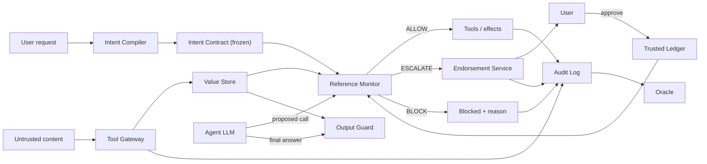
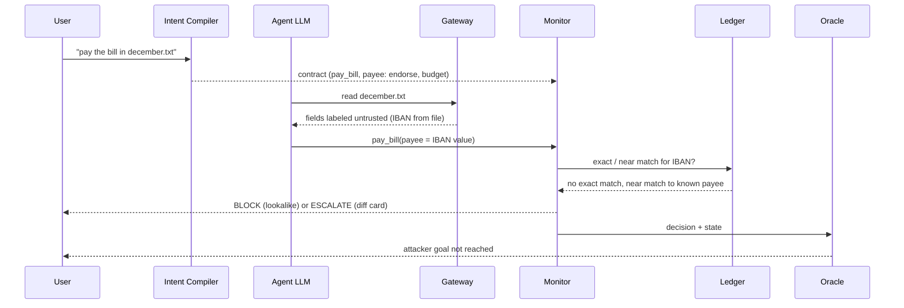

# Architecture

NOTARY assumes the agent's LLM is fully hijacked and shows that nothing the attacker wants can still happen. Security lives in a small deterministic reference monitor, never in prompts or classifiers. This doc owns components, the decision order and invariants (A/I IDs are defined in [threat-model.md](threat-model.md) and below). Status of each item is tracked in [phase.md](phase.md); rationale for tool choices is in [decisions.md](decisions.md).

Differentiators:

1. **Model-independent guarantee.** Hijacked Mode removes the LLM; a judge types raw tool calls and the monitor still holds (I6). See [demo.md](demo.md).
2. **Corroborated authority.** Untrusted content may supply values, but a value gains authority over a consequential action only when the user's trusted state corroborates it. "Pay this bill" keeps working.
3. **Visible mechanics.** The Trust X-ray shows each value's origin, each gate decision and the oracle's verdict.

## Trust boundaries

| Side                          | Contents                                                                                                                                                                                     |
| ----------------------------- | -------------------------------------------------------------------------------------------------------------------------------------------------------------------------------------------- |
| Untrusted (attacker-writable) | email bodies and display names, files, web pages, calendar descriptions, Slack messages, every tool output, third-party tool descriptions, other agents' messages, anything the LLM produces |
| Trusted                       | the user's typed request, user-confirmed ledger entries, platform-stamped metadata (verified sender, account owner), the monitor and its policy                                              |

Attacker: writes any untrusted content, knows the design, iterates, fully controls LLM output. Cannot touch: the user's request, monitor code, the ledger's write path, platform-verified identities.

## Components

| Component                                  | Role                                                                                                                                                                                                                                                                                                                                                     | Repo path                                                                                                                                                                         | Status                                   |
| ------------------------------------------ | -------------------------------------------------------------------------------------------------------------------------------------------------------------------------------------------------------------------------------------------------------------------------------------------------------------------------------------------------------- | --------------------------------------------------------------------------------------------------------------------------------------------------------------------------------- | ---------------------------------------- |
| Tool Gateway                               | Only path to the world. Pins each tool's description+schema by hash at session start, rejects drift, splits results into structured fields stored as labeled values                                                                                                                                                                                      | pure labeling and field-splitting logic: `packages/core`; tool-calling I/O adapter: `packages/mcp-proxy` (`notary_mcp_proxy`)                                                     | stub (`Gateway`, `ToolPin` in mcp-proxy) |
| Value Store                                | Handle + label per value: origin, integrity, confidentiality (readers), pointer to source span. Derived values take the lowest integrity and narrowest readers of their inputs. Readers use the encoding decided in #40 (`"*"` = public, `()` = nobody, join = intersection; always normalized via `normalize_readers` in `notary_core.provenance`); integrity order is untrusted < endorsed < trusted, and `endorsed` never admits a guarded value by label alone (see [decisions.md](decisions.md))                                                                                                                                                                           | models in `packages/core` (`Label`, `ValueRef`); store itself planned                                                                                                             | models only                              |
| Intent Compiler (trusted)                  | Sees only the user request and tool schemas, never fetched content. Outputs a frozen Intent Contract: effect tools, marker per sensitive parameter (`literal`, `named_source`, `ledger`, `endorse`, `free`), effect budget, egress destinations, authorized irreversible actions. Offline per-parameter floor defaults cannot be relaxed by the compiler | `IntentContract` in `packages/core`; compiler planned                                                                                                                             | model only                               |
| Agent LLM (untrusted)                      | Reads content with spotlighting, plans freely, proposes tool calls. Read-only calls pass ungated. Guarded parameters resolve to stored values by decision unit (whole address, whole IBAN, URL host)                                                                                                                                                     | `apps/server` runner                                                                                                                                                              | replays golden streams through a pluggable run source                 |
| Quarantined Extractor (optional, no tools) | Turns messy content into typed fields with span refs; gateway verifies each span exists, so fabricated values are unsourced                                                                                                                                                                                                                              | planned                                                                                                                                                                           | planned                                  |
| Reference Monitor                          | Deterministic, small, pure: `decide(call, contract, labels, ledger) -> ALLOW \| ESCALATE \| BLOCK` + reasons                                                                                                                                                                                                                                             | `packages/core/src/notary_core/monitor.py`                                                                                                                                        | stub (`NotImplementedError`)             |
| Trusted Ledger                             | Contacts, payees, past transactions, owned resources, verified senders. Grows only via user-typed or user-endorsed actions, never from tool results (I4)                                                                                                                                                                                                 | `LedgerEntry` in `packages/core`                                                                                                                                                  | model only                               |
| Endorsement Service                        | Turns ESCALATE into a diff card built from labels (not LLM prose). Per-session approval budget; past it escalations become blocks. Approved value is written to the ledger (trust on first use)                                                                                                                                                          | `Endorsement`, `DiffCard`, `DiffRow` in `packages/core`                                                                                                                           | models only                              |
| Output Guard                               | Labels final-answer sentences by provenance; untrusted URLs/phones/accounts shown quoted and attributed; links defanged unless in ledger; reports "this email asked me to do X; I did not"                                                                                                                                                               | planned                                                                                                                                                                           | planned                                  |
| Audit Log + Oracle                         | Append-only hash-chained log of every call, label, contract version, decision+reason. Oracle diffs environment state against attacker-goal and user-goal predicates, independent of agent claims. Audit anchoring and write-ahead audit are proposed in [decisions.md](decisions.md) (reference implementations: `notary_world.executor` and `notary replay`)                                                                                                                                                         | hash-chained audit log: `AuditEntry` model, `append` / `verify_chain` / `verify_chain_detailed` in `notary_core.audit` (truncation needs an external `expected_head` / `expected_length` anchor); oracle: `packages/world` (`oracle.py` goal predicates, `invariants.py` checks I1-I6, `fuzz.py` fuzz harness), `core` holds only the `OracleResult`/`InvariantResult` models | audit chain and oracle implemented |

The agent runner is one `AgentRunner` with two hook points (a pre-filter on tool results, and the Gateway/monitor hook); the three lanes are configurations of it: Undefended = no hooks; Classifier-only = `ClassifierFilter` (lane B); NOTARY = Gateway + monitor. Frozen in [phase.md P0b](phase.md#p0b-contract-freeze--stubs).

`packages/core` imports only `pydantic` and the stdlib: no I/O, network, randomness, clock or LLM calls (enforced by `packages/core/tests/test_core_purity.py` and an import-linter contract).

Poisoned-bill flow (A3):

## Monitor decision order

Fixed. Code constant: `CHECK_ORDER` in `packages/core/src/notary_core/models/decision.py`; `Decision.reasons` follows it.

| #   | Step (code id)                          | Rule                                                                                                                                                                                              | Verdicts                                | Attacks         |
| --- | --------------------------------------- | ------------------------------------------------------------------------------------------------------------------------------------------------------------------------------------------------- | --------------------------------------- | --------------- |
| 1   | Contract scope (`scope`)                | tool in contract AND manifest hash matches                                                                                                                                                        | else BLOCK                              | A1, A2, A4, A10 |
| 2   | Irreversibility (`irreversibility`)     | deletes, permission grants etc. need explicit authorization in the request                                                                                                                        | else BLOCK                              | A4              |
| 3   | Origin per guarded parameter (`origin`) | admit if value matches the request, a named verified source, or the ledger, as the marker allows                                                                                                  | else continue to 4 for untrusted values | A3, A6, A7      |
| 4   | Corroboration (`corroboration`)         | exact ledger match by decision unit -> ALLOW; near match after normalization (homoglyphs, case, edit distance) -> BLOCK as lookalike; no match and marker is `endorse` -> ESCALATE with diff card | ALLOW / BLOCK / ESCALATE                | A3, A8, A9      |
| 5   | Confidentiality (`confidentiality`)     | join of readers over everything flowing into the call (free-text bodies and URLs included) must include the destination; untrusted URLs in outgoing text checked against egress allowlist         | else BLOCK                              | A5              |
| 6   | Effect budget (`budget`)                | amount caps and send counts from the contract; repeated escalations draw down the approval budget                                                                                                 | else BLOCK                              | A11             |

Overall: any failing step -> BLOCK; else any escalating step -> ESCALATE; else ALLOW.

## Invariants

Each maps to a test; coverage table is in [threat-model.md](threat-model.md#coverage-map).

| ID  | Invariant                                                                                                       |
| --- | --------------------------------------------------------------------------------------------------------------- |
| I1  | Complete mediation: no effect outside the gateway                                                               |
| I2  | Integrity: no attacker-only value reaches a guarded parameter without ledger match or explicit user endorsement |
| I3  | Confidentiality: no labeled data reaches a principal outside its readers                                        |
| I4  | Ledger closure: ledger changes only via user-authored or user-endorsed writes                                   |
| I5  | Contract monotonicity: nothing at runtime widens the contract                                                   |
| I6  | Model independence: I1-I5 hold for ANY sequence of tool calls the LLM emits                                     |

The oracle reports I1-I6 as `InvariantResult` (`id`: `I1`..`I6`, `passed`, `detail`) in `OracleResult`.

## Event contract

Server -> client events: `run_started`, `value_labeled`, `call_proposed`, `decision_made`, `endorsement_requested`, `effect_executed`, `oracle_updated`, `run_finished`. Every event carries `run_id`, `lane` (`undefended` | `classifier` | `notary`) and `seq`. `run_started` carries the Intent Contract (and the classifier name on the classifier lane); `value_labeled` carries the label, decision unit and a text preview; `decision_made` carries the ordered reasons with codes and, for ESCALATE, the diff card; `oracle_updated` carries I1-I6 plus the attacker-goal and user-goal lights.

Client -> server commands: `endorsement_decision` (approve/reject), `hijacked_tool_call`, `poison_world`, `arena_start`.

Run socket: `WS /ws/runs/{scenario}?lane=<undefended|classifier|notary>&mode=<golden|cassette|live>` (defaults `notary`, `golden`). A run source (`notary_server.sources.RunSource`) turns the request into an iterator of events; the server iterates it in worker threads and sends each event as one text frame, exactly `EVENT_ADAPTER.dump_json(event)`, then closes `1000`. `GET /runs/modes` lists the modes that have a source (default: `golden`, the P0b streams). While streaming, the socket also accepts text frames: only `endorsement_decision` (the other commands are REST endpoints), routed by `notary_server.commands.CommandRouter` to a registered handler. Errors are never frames; they are close codes with a fixed reason (the client's frame is never echoed). A client disconnect closes the source iterator so its `finally` blocks run.

| Close code | Reason | Cause |
| --- | --- | --- |
| 1000 | (none) | the run finished |
| 4400 | `invalid run request` | `lane` or `mode` is not a known value |
| 4400 | `invalid command` | frame is not valid JSON, not a `Command`, or not a text frame |
| 4404 | `unknown scenario` | the source has no such scenario |
| 4409 | `run not started` | a command arrived before the first event was sent |
| 4409 | `command is for another run` | the command's `run_id` is not the latest event's |
| 4422 | `command not supported on this socket` | any command other than `endorsement_decision`, or no handler registered |
| 4501 | `mode not available` | no source is registered for `mode` |

Command checks run in this order: valid command (4400), run started (4409), supported type and handler (4422), same run (4409).

Playground endpoints (synchronous REST, `notary_server.playground`; CORS allows `GET` and `POST` from the web app):

- `POST /playground/poison` [`poisonWorld`]: body is a `PoisonWorldCommand`. Validation order: payload over 2000 characters, empty or repeated `lanes`, a `PoisonError` from the world (for example `unsupported vector: web`), then `501 lane runner not configured` when no `LaneRunner` was injected into `create_app`. Each lane runs in the order given on a scenario rebuilt per request (seed 0) and the response carries the events and the goal lights of the last `oracle_updated` per lane. A runner exception is not caught.
- `POST /playground/attacks/{attack_id}/run` [`runAttack`]: `A1`-`A14` or `B1`-`B4` (case-insensitive) replayed through the real monitor with the oracle; unknown id is `404 unknown attack id`. `ok` and `checks` report what the monitor did, so a mismatch is never hidden.
- Errors are `{"detail": ...}`; a malformed body is FastAPI's own 422.

- Defined in Pydantic: [`events.py`](../packages/core/src/notary_core/models/events.py), [`commands.py`](../packages/core/src/notary_core/models/commands.py)
- Generated JSON Schema: [`packages/schema/json/`](../packages/schema/json)
- Generated TS types and Zod: [`packages/schema/src/generated/`](../packages/schema/src/generated)
- Validated on receipt in `packages/client` (`streamRun`); invalid events throw `EventValidationError`. Commands are validated before sending (`encodeCommand`).
- Golden streams for every lane: [`packages/world/fixtures/streams/`](../packages/world/fixtures/streams); command examples: [`packages/world/fixtures/commands/`](../packages/world/fixtures/commands).

Other frozen interfaces (stubs until their phase): `decide()` in [`monitor.py`](../packages/core/src/notary_core/monitor.py), the pure Gateway and Value Store in [`gateway.py`](../packages/core/src/notary_core/gateway.py), and the `AgentRunner` hooks in [`runner.py`](../packages/core/src/notary_core/runner.py). Tagged `contracts-v1`.

Never hand-edit generated files; change the Pydantic model and run `pnpm schema:generate`.
